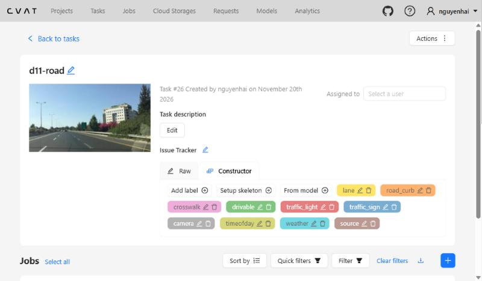
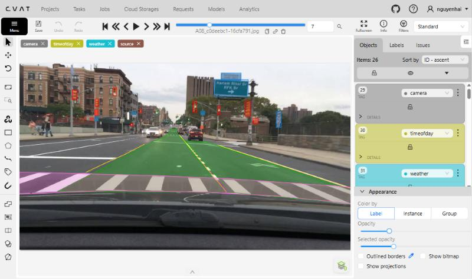
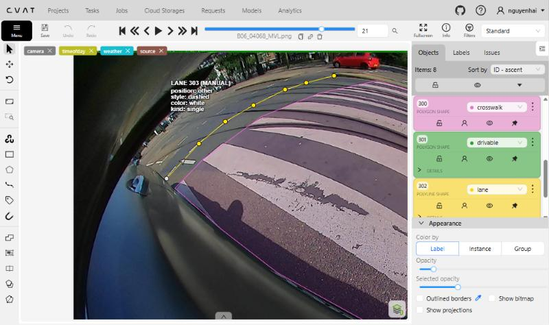
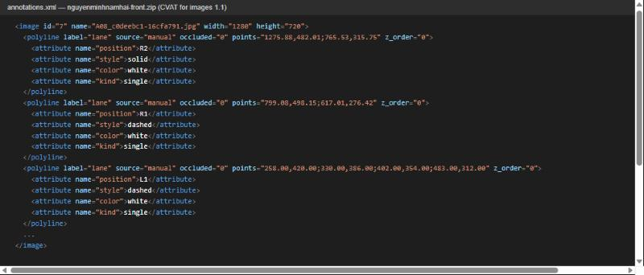

# Báo cáo cá nhân — Ngày 11
Họ tên: Nguyễn Minh Nam Hải    Mã học viên: 2A202603076
Phiên bản CVAT (Help → About): 2.74.1
Guideline: Road v1.0    Lần nộp (`revision` trong manifest): 3
Thời điểm export (ngày giờ trên CVAT): 2026-11-20 15:45:53 UTC    Số lần nộp lại sau Rework: 0

## 1. Kiểm project
| Mục | Đúng như guideline Road v1.0? | Ghi chú |
| --- | --- | --- |
| 6 label, đúng kiểu | Đúng | lane, road_curb: polyline · crosswalk, drivable: polygon · traffic_light, traffic_sign: rectangle |
| Thuộc tính và giá trị | Đúng | Lint không báo QC1-12 |
| 4 tag ảnh | Đúng | 28/28 ảnh đủ 4 tag (manifest) |

Cách kết thúc polyline trên bản CVAT này: phím **N**.
Cách đặt tag ảnh trên bản CVAT này: công cụ **Tag** ở thanh trái; kiểm giá trị trong **Details** vì CVAT tự điền giá trị đầu danh sách.

## 2. Số lượng đã gán
| Task | Ảnh | lane | road_curb | crosswalk | drivable | traffic_light | traffic_sign |
| --- | ---: | ---: | ---: | ---: | ---: | ---: | ---: |
| front | 12 | 30 | 6 | 4 | 24 | 29 | 28 |
| front-extra (đã làm 4 / 4) | 4 | 11 | 0 | 2 | 7 | 8 | 12 |
| fisheye | 8 | 6 | 6 | 8 | 9 | 4 | 4 |
| fisheye-extra (đã làm 4 / 4) | 4 | 0 | 3 | 4 | 4 | 0 | 1 |

## 3. Bảng ca khó
| Ảnh | Nhãn | Phân vân giữa | Đã chọn | Lý do |
| --- | --- | --- | --- | --- |
| A05 | lane | Vẽ L1/R1 hay không | Không vẽ | Không thấy vạch sơn hai bên làn |
| A09 | lane | Vẽ R1 hay `road_curb` | `road_curb` | Bên phải là vỉa hè, không có vạch sơn |
| A04, A09, A11, A14 | lane | Một hay nhiều polyline cho vạch đứt | Một polyline | Vạch đứt là một vạch (QC1-05) |
| B06, B08 | lane | `L1`/`R1` hay `other` | `other` | Camera hai bên phải dùng `other` (QC1-03) |
| B04 | traffic_sign | `edge_zone` bật hay tắt | Bật | Tâm box ngoài 80 % bán kính ảnh |
| B08, B09 | lane, road_curb | 2 điểm hay nhiều điểm | Nhiều điểm theo cung | Fisheye làm đường thẳng bị cong (QC1-11) |

## 4. Phiếu QC 1 nhận được
Bạn kiểm lô của tôi: Kiều Quang Trường (2A202603205)    Quyết định nhận được: Release
| Mã lỗi | Số lỗi | Đồng ý? | Đã sửa? |
| --- | ---: | --- | --- |
| QC1-02 (nặng) | 3 | Không: A05, A09 thật sự không có vạch | Không; coach đã xác nhận miễn QC1-02 |

Tự sửa theo lint trước khi nộp: revision 1 có 11 nặng / 14 chính. Revision 2 còn 6 nặng: đã sửa `position` lane, gộp vạch đứt, chiều vẽ A10/A11, `other` cho B06/B08, điểm theo cung trên fisheye. Revision 3 còn 3 nặng: đã thêm L1 cho A06, A07, A08.

## 5. Kiểm file export
| File | Mở lại được? | Số shape ảnh 1 (job / file) | Số shape ảnh 2 (job / file) | Tag camera có trong XML? |
| --- | --- | --- | --- | --- |
| `nguyenminhnamhai-front.zip` | Có | A01: 9 / 9 | A02: 7 / 7 | Có |
| `nguyenminhnamhai-fisheye.zip` | Có | B01: 3 / 3 | B02: 6 / 6 | Có |

## 6. Ảnh chụp màn hình
1. Tab Labels của project: 
2. Ảnh front đã gán đủ: 
3. Ảnh fisheye, phóng to polyline cong: 
4. XML có `<polyline label="lane">`: 

## 7. Tự đánh giá
Lỗi bạn mắc nhiều nhất hôm nay (theo mã QC1-xx), và cách tránh ở Ngày 20:
QC1-02 / QC1-05: tôi để `position` mặc định `L1` cho mọi lane. Ngày 20: đổi `position` ngay sau khi bấm N, và chạy lint sau mỗi task.

Nhãn của bạn đi vào model ở đâu? Chọn một lỗi đã sửa và nói nó làm model học sai thế nào:
`position` của lane là đích để model biết đâu là biên trái/phải của làn xe. Ở A04, bốn vạch đều là `L1`, nên model học sai biên phải. Khi đó LKA tính sai tâm làn và lái lệch.

## 8. (Tùy chọn, buffer) Từ polyline đến đích row-anchor
Không làm.
